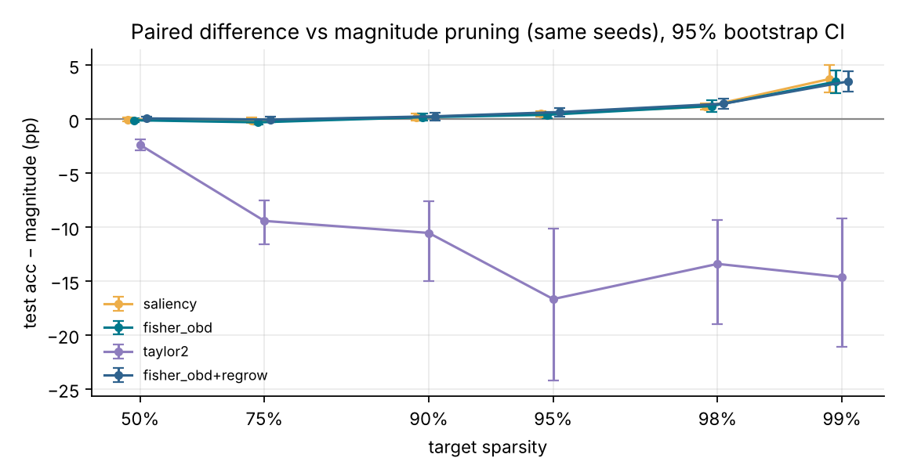
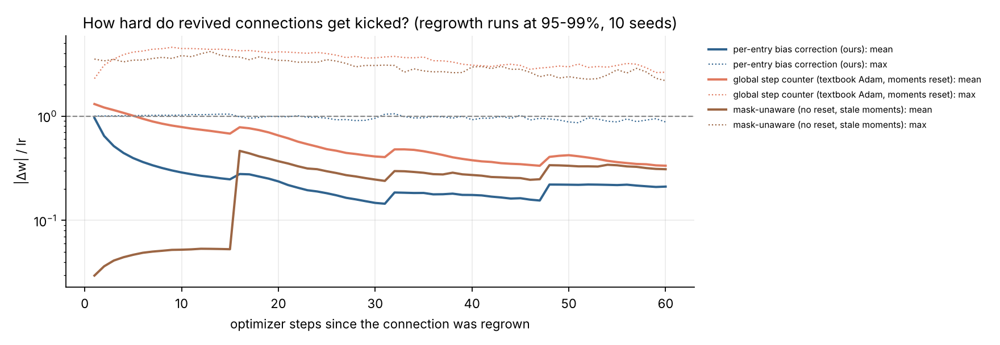
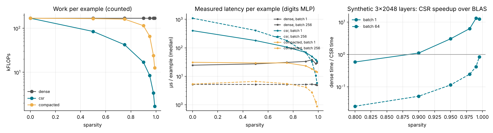

# DESIGN

Contents

1. [Architecture in one picture](#1-architecture)
2. [The importance criterion: derivation](#2-importance-criterion)
3. [What is "the gradient of a masked weight"?](#3-gradient-of-a-masked-weight)
4. [The optimizer and the revival bug](#4-optimizer-and-the-revival-bug)
5. [Schedule, budget and regrowth](#5-schedule-budget-regrowth)
6. [Evidence: what counts and what does not](#6-evidence)
7. [Where the autodiff engine bottlenecks](#7-bottlenecks)
8. [Serving a self-pruned model in a multi-tenant service](#8-serving)
9. [Known limitations](#9-limitations)

---

## 1. Architecture

```
aqua/engine   Tensor + ops + backward()   ── knows nothing about masks
aqua/nn       Parameter(mask) , MaskedLinear: y = x @ (W ⊙ M) + b
aqua/optim    Adam / SGD subscribe to Parameter.set_mask → reset per-entry state
aqua/prune    statistics (after_backward) → scores → set_mask (after_step)
aqua/sparse   export → CSR kernel / exact compaction → graph-free inference
aqua/train    data, mini-batch loop with hooks
```

There is exactly **one** way to change the topology: `Parameter.set_mask`. It
(1) writes a real `0.0` into removed entries and (2) notifies every subscribed
optimizer, which resets `m`, `v` and the step clock of every entry whose
existence changed. The pruner never touches optimizer internals, so the two
can't fall out of sync, and that kind of desync is where most bugs in this
area come from.

The engine has no special case for masks. A mask is a constant in the graph,
so the gradient that reaches `W` is the exact derivative of the function the
network computes, and finite differences can check it.

---

## 2. Importance criterion

### What we want to estimate

Removing connection *i* moves the parameters from θ to θ − wᵢ eᵢ. The quantity
we want to rank by is the loss it costs:

```
ΔLᵢ = L(θ − wᵢ eᵢ) − L(θ)
```

A second-order Taylor expansion around θ in the direction −wᵢ eᵢ gives

```
ΔLᵢ ≈ −gᵢ wᵢ + ½ Hᵢᵢ wᵢ²          g = ∇L,  H = ∇²L
```

(the off-diagonal terms Hᵢⱼ are dropped. That's the "diagonal" assumption of
Optimal Brain Damage, LeCun et al. 1990. It ignores interactions between
connections removed in the same step, which is one reason we prune gradually.)

### Estimating H cheaply: the per-example empirical Fisher

For softmax cross-entropy the Hessian is the generalized Gauss–Newton matrix
plus a term that vanishes as residuals shrink. The GGN is the (true) Fisher,
F = E[∇ℓₙ ∇ℓₙᵀ], whose diagonal we approximate with the empirical Fisher using
the data labels:

```
Fᵢᵢ = (1/N) Σₙ (∂ℓₙ/∂wᵢ)²
```

The mistake people usually make here is to square the **mini-batch** gradient.
That estimates (E g)² + Var(g)/N, not E[g²], and under-counts curvature by
roughly a factor of the batch size. We need per-example gradients, which a
linear layer makes cheap. For y = xW, ∂ℓₙ/∂Wᵢⱼ = xₙᵢ dₙⱼ, and with a mean loss
the batch gradient at the pre-activation is G = d/N, so

```
F = (1/N) (x²)ᵀ (d²) = N · (x²)ᵀ (G²)        one extra matmul per layer per step
```

`aqua/prune/criteria.py::per_example_fisher`, checked against brute-force
per-example backprop in `tests/test_pruning.py::FisherTrick`.

### The four criteria we implemented

| name | score (keep if high) | what it assumes |
|---|---|---|
| `magnitude` | \|w\| | g = 0 and H = c·I (all weights equally curved) |
| `saliency` | E\|w g\| | first-order magnitude, averaged over steps (Molchanov et al.) |
| `taylor2` | ½ F w² − ḡ w | the full second-order expansion above |
| `fisher_obd` | ½ F w² | the expansion without the first-order term |

Statistics are bias-corrected EMAs (β = 0.9, about a one-epoch window) of the
dense gradient ∂L/∂W_eff and of per-example F, collected only around the
pruning window.

### Why `fisher_obd` and not the "complete" `taylor2`

This is what we found, and we didn't expect it going in. On the pilot (seeds
0–3, validation split) the "more complete" `taylor2` was the **worst**
criterion by a wide margin (≈83% vs ≈96% at 98% sparsity). Dropping its
first-order term fixed it. There are three reasons:

1. **The linear term is a local prediction about a non-local move.** −ḡw is
   accurate for an infinitesimal step, but removal moves the weight all the
   way to 0. For any weight Adam is still actively moving, ḡ points along the
   current trajectory and −ḡw is large and signed. It predicts that removing
   a weight on its way to a larger value *lowers* the loss, so that weight gets
   pruned first.
2. **Near a minimum E[g] ≈ 0, but ḡ is noisy.** Our MLP fits the training set
   by about epoch 10 (train loss ≈ 1e-3). Past that point ḡ is mostly
   mini-batch noise, and a signed noise term reshuffles the ranking.
3. **Removals that are always beneficial are rare in practice.** When they
   happen the expected gain is small; when the sign is wrong, the cost is large.

`fisher_obd` keeps the term that does carry information: how sharply the loss
curves along this weight, in loss units.

### Why `saliency` and `fisher_obd` tie

E|w g| = |w|·E|g| and ½E[g²]w² = ½(|w|·RMS(g))². Both rank by
**|w| × the gradient's typical size**. Since E|g| ≤ RMS(g) with roughly
constant ratio across entries, the two orderings are nearly identical.
Averaging the *absolute value* of the first-order term turns it into a
curvature proxy. That's why |w·g| works, and also why it isn't really a
first-order criterion.

### Why it beats magnitude

Magnitude assumes every weight sits in an equally curved valley. In reality
curvature varies by orders of magnitude between weights: an input pixel that
is always 0 after standardization makes its weights nearly free to delete
whatever their size, and a hidden unit feeding many confident logits makes its
weights expensive. Fisher-OBD weights |w|² by exactly that curvature.

### Global ranking

Fisher-OBD is in **loss units**, so one ranking across layers is meaningful.
Magnitudes aren't comparable across layers: He initialization alone makes
layer-1 weights √(256/64) = 2× larger than layer-2 weights. We still run
magnitude globally in the headline comparison, because global magnitude
validated better than per-layer magnitude (we compare against the baseline's
strongest version). Per-layer runs of both are in the ablations. A floor
(`min_layer_density`, default 0.5%) prevents a layer from being severed
entirely, and when the floor is infeasible under the budget the budget wins.

---

## 3. Gradient of a masked weight

There are two different gradients, and conflating them is the root of most
bugs:

| quantity | value at a masked entry | used for |
|---|---|---|
| ∂L/∂W  = M ⊙ ∂L/∂W_eff | **exactly 0** | the optimizer |
| ∂L/∂W_eff (dense) | generally ≠ 0 | regrowth: "what if this connection existed?" |

**What the engine computes for the weight is ∂L/∂W = M ⊙ ∂L/∂W_eff, an exact
zero for masked entries.** That's the right choice because:

* It's the **true derivative** of the function being computed. Perturbing a
  masked weight cannot change the output, and the finite-difference check
  returns exactly 0 too (`test_masked.py`). Any other value is a modelling
  decision disguised as a gradient.
* A non-zero gradient on a removed weight (the straight-through choice) makes
  the optimizer move it, so the stored value stops being zero, and when it is
  later revived it comes back with a value it never "earned" in the forward
  pass. Straight-through is a legitimate *estimator* for dynamic sparse
  training, but it's a different algorithm and needs to be chosen
  deliberately.
* It still leaves the dense signal available. `MaskedLinear` keeps
  `last_w_eff.grad`, and regrowth ranks dead entries by |E[∂L/∂W_eff]|
  (RigL). We need it there, because a pruned weight has w = 0 and masked
  gradient 0, so **|w·g| is identically 0 for every pruned weight**. A
  saliency criterion computed from the masked gradient can never revive
  anything.

---

## 4. Optimizer and the revival bug

### Failure mode 1: stale momentum ("zombie weights")

If the masked gradient is zero but the optimizer keeps stepping, Adam's m
decays as β₁ᵏ yet keeps producing updates m̂/√v̂ ≠ 0. The stored weight drifts
away from zero for roughly 1/(1−β₁) steps. The forward pass still multiplies
by the mask, so nothing looks wrong, until the connection is revived carrying
that drifted value. Decoupled weight decay leaks into removed entries the same
way. `mask_aware=False` reproduces this, and `test_masked.py` asserts it
happens.

### Failure mode 2: what most quick implementations still get wrong

The usual fix is to reset m and v for pruned and revived entries. That isn't
enough. Adam's bias correction divides by (1 − βᵗ) with a single global step
counter t. A connection revived at global step T has fresh moments, so after k
steps with a steady gradient g:

```
m = (1−β₁ᵏ) g        v = (1−β₂ᵏ) g²
m̂ / √v̂ = (1−β₁ᵏ)/(1−β₁ᵀ⁺ᵏ) · √(1−β₂ᵀ⁺ᵏ)/√(1−β₂ᵏ) · sign(g)
       ≈ (1−β₁ᵏ) / √(1−β₂ᵏ)           (T large)
```

| k (steps since revival) | 1 | 2 | 5 | 10 | 50 | 100 | 500 |
|---|---|---|---|---|---|---|---|
| step / lr | **3.16** | 4.25 | 5.80 | **6.53** | 4.50 | 3.24 | 1.59 |

A fresh Adam parameter takes a step of exactly lr·sign(g) at k = 1. A revived
one takes 3.16× that, peaks at 6.5× around k = 10, and is still 1.6× too large
500 steps later. In other words, the correction for bias at small t is missing
from the very entries that just restarted. Nothing crashes and gradient checks
pass, because the gradients are right; the optimizer is wrong. It shows up as
"regrowth is unstable", and that gets blamed on regrowth.

### The fix

Each entry has its own clock, `t ∈ ℤ^{shape(W)}`, which advances only while the
entry is alive and resets to 0 when its existence changes. Bias correction
uses that clock. Removed entries keep m = v = t = 0 and receive no update, and
weight decay is masked.

**The invariant we test (`test_masked.py::RevivalBug`):** a connection revived
at step 5000 produces a trajectory bit-for-bit identical (rtol 1e-12) to a
freshly created parameter fed the same gradients. The textbook variant fails
it by exactly the closed form above. A further oracle test checks the
optimized implementation against a direct transcription under random mask
churn.

SGD with momentum has no bias correction, so resetting the velocity of changed
entries is sufficient there.

**Cost:** an `int32` clock per weight, i.e. +25% optimizer state over float64
(m, v). A cheaper equivalent is one `int32` "birth step" per entry
(t = global − birth), the same memory. Clamping at 2¹⁶ is exact in float64
because β₂^65536 < 1e-28. Inference never sees any of it.

### In real training, not just a unit test

`RevivalMonitor` records |Δw|/lr for every regrown connection by age.
Measured results are in [section 6](#revival-telemetry).

---

## 5. Schedule, budget, regrowth

* **Cubic ramp** (Zhu & Gupta 2017): s(t) = s_f · (1 − (1 − τ)³) for
  τ ∈ [0, 1] between 10% and 65% of training, with a mask update every 16
  steps (one epoch). Removal is fastest early, while the network is redundant
  and recovers quickly. ds/dt → 0 at the end, so the last and most damaging
  cuts are small and widely spaced. The final 35% is fine-tuning at a frozen
  topology under a cosine LR decay. One-shot pruning at the end would skip the
  recovery entirely and rely on the diagonal-Hessian approximation for a single
  huge, non-local move. Gradual pruning keeps each step small.
* **Hard budget:** at the last ramp step exactly round(s_f · n) weights are
  removed (per layer, or in total for global scope), asserted in tests and
  re-checked on every row of the sweep CSV.
* **Regrowth (RigL-style drop-and-grow):** at each update until 80% of
  training, drop the α lowest-scoring live weights in a layer and grow the α
  dead ones with the largest |E[∂L/∂W_eff]|, with α = 0.2·cos-decay. Density is
  unchanged, so the budget holds exactly. For stability:
  * a grown weight starts at **exactly 0**, so the function is unchanged at
    the moment of growth (no loss spike);
  * it gets **fresh optimizer state with its own clock** (section 4);
  * it is **protected for one window**, since a zero weight scores ≈ 0 and
    would otherwise be dropped at the next update before it could learn;
  * α decays to 0, so the topology settles before fine-tuning.

---

## 6. Evidence

All numbers: UCI digits, MLP 64-256-256-10 (84,480 prunable weights), 60
epochs of Adam (lr 2e-3, cosine), model seeds **100–109** (the pilot used 0–3),
held-out test split of 359 images (one image = 0.279 pp). Raw rows:
`results/part4/sweep_raw.csv` (450 runs). Derived statistics:
`results/part4/summary.json`.

### 6.1 Sparsity–accuracy Pareto curve


Test accuracy, mean ± std over 10 seeds (dense: **96.99 ± 0.39**):

| sparsity | magnitude | saliency | **fisher_obd** | fisher_obd + regrow | taylor2 |
|---|---|---|---|---|---|
| 50% | 97.05 ± 0.27 | 97.02 ± 0.26 | 96.96 ± 0.40 | 97.13 ± 0.44 | 94.68 ± 0.78 |
| 75% | 97.13 ± 0.44 | 97.02 ± 0.23 | 96.85 ± 0.26 | 97.10 ± 0.27 | 87.72 ± 3.37 |
| 90% | 96.82 ± 0.46 | 97.02 ± 0.26 | 97.02 ± 0.40 | 97.10 ± 0.44 | 86.30 ± 6.91 |
| 95% | 96.35 ± 0.52 | 96.88 ± 0.47 | 96.77 ± 0.51 | 97.02 ± 0.44 | 79.69 ± 12.1 |
| 98% | 94.79 ± 0.57 | 95.96 ± 0.61 | 96.02 ± 0.63 | 96.24 ± 0.65 | 81.39 ± 8.42 |
| 99% | 91.11 ± 1.73 | 94.85 ± 1.08 | 94.60 ± 0.91 | 94.62 ± 0.89 | 76.49 ± 10.9 |

Every run met its budget exactly (re-checked row by row in `tests/test_claim.py`).

### 6.2 Baseline comparison: is it better than magnitude, and is it real?



Paired by seed (same init, data order and split): mean difference, 95%
bootstrap CI, exact sign-flip permutation p, and wins/ties/losses out of 10.

| sparsity | fisher_obd − magnitude | p | W/T/L | saliency − magnitude | p |
|---|---|---|---|---|---|
| 50% | −0.08 pp [−0.25, +0.11] | 0.39 | 2/3/5 | −0.03 pp | 0.88 |
| 75% | −0.28 pp [−0.50, −0.08] | 0.06 | 0/5/5 | −0.11 pp | 0.56 |
| 90% | +0.19 pp [−0.11, +0.50] | 0.35 | 5/2/3 | +0.19 pp | 0.34 |
| 95% | +0.42 pp [+0.11, +0.70] | 0.045 | 8/0/2 | +0.53 pp | 0.008 |
| 98% | **+1.23 pp [+0.70, +1.75]** | **0.008** | 9/0/1 | +1.17 pp | 0.002 |
| 99% | **+3.48 pp [+2.42, +4.51]** | **0.002** | 10/0/0 | +3.73 pp | 0.002 |

**What we conclude, and how far it goes:**

* **Up to 90% sparsity the criterion doesn't matter here.** Every reasonable
  criterion stays within noise of dense. The net is so over-parameterized that
  even magnitude pruning finds a good 10% subnetwork. At 75% the magnitude
  baseline is even marginally ahead (−0.28 pp, p = 0.06): that's not
  significant, but we don't hide it.
* **The gradient-informed criteria win where the budget gets tight**:
  +0.4–0.5 pp at 95%, about +1.2 pp at 98%, about +3.5 pp at 99%. All are
  significant, and the effect grows with sparsity, as it should if magnitude's
  "equal curvature" assumption is what's breaking.
* **Saliency and Fisher-OBD are indistinguishable**, as predicted in section 2.
* **The signed second-order Taylor criterion is much worse everywhere**
  (−2.4 pp at 50%, −13 to −17 pp at 95–99%), with large seed variance. The
  "more complete" expansion is the wrong tool here (section 2).
* **Scope ablation (per-layer instead of global):** both criteria lose
  accuracy, and magnitude loses far more (99%: 85.4% layer vs 91.1% global),
  so the per-layer gap is larger: Fisher-OBD − magnitude = +1.25 pp at 95%,
  +1.73 pp at 98%, +6.10 pp at 99% (all p ≤ 0.006). The headline compares
  against magnitude's *stronger* global variant.

### 6.3 Regrowth and the optimizer revival bug: honest outcome

| comparison (10 paired seeds) | 95% | 98% | 99% |
|---|---|---|---|
| fisher_obd + regrow − fisher_obd | +0.25 pp (p 0.34) | +0.22 pp (p 0.31) | +0.03 pp (p 0.98) |
| textbook global-t Adam − correct (both with regrowth) | −0.08 pp (p 0.77) | −0.20 pp (p 0.09) | +0.36 pp (p 0.41) |
| mask-unaware Adam − correct (both with regrowth) | +0.03 pp (p 0.88) | +0.08 pp (p 0.79) | +0.11 pp (p 0.70) |

* **Regrowth** is never significantly better here. It's directionally
  positive at 50–98%, which is consistent with RigL's results, but small
  against seed noise on a task where pruning alone already almost matches
  dense.
* **The revival bug does not measurably change final accuracy on this
  task.** We report that plainly rather than claim the fix "saves" accuracy.
  It does change optimizer behaviour by exactly the predicted amount (6.4
  below). Plausible reasons it doesn't reach the accuracy number here: regrown
  weights are about 20% of a small live set and start at 0, cosine LR decay
  shrinks every step late in training, many regrown weights are dropped again
  at the next update, and the problem is easy. We'd expect the bug to matter
  more with larger learning rates, longer constant-LR phases or harder tasks,
  but **we have not shown that**, so we don't claim it. The fix is justified
  by correctness (the bit-exact equivalence test), not by this benchmark.

<a id="revival-telemetry"></a>
### 6.4 Revival telemetry from real training runs



`RevivalMonitor` records |Δw|/lr for every regrown connection, by steps since
regrowth. It pools 30 runs per variant (95/98/99% × 10 seeds) with about 3.5M
revived-connection samples at age 1 (`results/part4/revival.json`).

| variant | mean at k=1 | k=5 | k=10 | k=30 | worst single step |
|---|---|---|---|---|---|
| per-entry clock (ours) | **0.96** | 0.40 | 0.29 | 0.15 | **1.05** |
| textbook global-t, moments reset | 1.30 | 1.01 | 0.79 | 0.41 | **4.56** |
| mask-unaware (no reset) | 0.03 | 0.05 | 0.05 | 0.25 | 4.15 |

* **Ours behaves like a fresh Adam parameter.** The first step is lr·sign(g)
  (0.96 rather than 1.00 only because of ε on tiny gradients), never more than
  1.05 lr. Afterwards it decays as gradient noise makes m̂/√v̂ < 1.
* **Global-t** takes 1.36× larger steps on average at k=1, about 2.7× at
  k=10–30, and single steps up to 4.6× lr. In these runs regrowth happens
  between steps 96 and 768, where the global correction √(1−β₂ᵗ) is still
  noticeably below 1, so the inflation is smaller than the 3.16–6.5×
  asymptote. Revive later in a longer run and it converges to the closed form
  (asserted in `RevivalBug`).
* **Mask-unaware** fails the *opposite* way. Stale second moments from a
  connection's previous life make revived weights nearly frozen (0.03 lr),
  so regrowth is almost a no-op. The occasional 4× outlier comes from stale
  first moments.
* The steps in the curves at ages 16, 32 and 48 are a **survivorship effect**,
  not an optimizer effect. Every 16 steps the next mask update re-drops the
  lowest-scoring regrown weights, and those are the ones taking the smallest
  steps, so the surviving population shifts upward.

### 6.5 Real cost: did it actually get cheaper?

`python scripts/benchmark.py` (seed 100 Fisher-OBD models, the same runs as
the sweep). Every engine's output is asserted equal to the training forward
pass (1e-9) before it's timed. Median latency over ≥15 timed calls after
warm-up, single-threaded, on the 2-core cloud VM listed in
`cost_environment.json`.



| sparsity | FLOPs/example dense | CSR | compacted | compacted shapes | µs @1 dense | CSR | compacted | µs @256 dense | CSR | compacted | speedup @256 |
|---|---|---|---|---|---|---|---|---|---|---|---|
| 0% | 168,960 | 168,960 | 168,960 | 64-256-256-10 | 24.5 | 401 | 31.0 | 1,325 | 280,639 | 1,362 | 0.97× |
| 50% | 168,960 | 84,480 | 165,336 | 59-256-254-10 | 27.2 | 180 | 29.3 | 1,317 | 104,457 | 1,689 | 0.78× |
| 90% | 168,960 | 16,896 | 114,440 | 56-204-214-10 | 33.3 | 68.7 | 23.3 | 1,319 | 17,677 | 1,063 | 1.24× |
| 95% | 168,960 | 8,448 | 65,716 | 56-144-161-10 | 37.9 | 49.7 | 18.1 | 1,347 | 8,362 | 700 | 1.92× |
| 98% | 168,960 | 3,380 | 24,036 | 54-81-84-10 | 28.0 | 38.1 | 15.0 | 1,291 | 2,749 | 324 | **3.98×** |
| 99% | 168,960 | 1,690 | 12,560 | 54-52-56-10 | 29.9 | 33.8 | 14.1 | 1,263 | 1,493 | 226 | **5.58×** |

**What this does and doesn't show:**

* **The dense engine does the same work at every sparsity.** It's the
  "dense × zeros" shortcut: 168,960 FLOPs whether 0% or 99% of the weights
  are zero, and the same latency. It's included only as the baseline, and it
  is *not* a speedup.
* **Unstructured CSR is a real FLOP reduction (100× at 99%) but not a
  latency win on this model.** A NumPy gather + `reduceat` kernel can't match
  BLAS on small matrices: it's slower at every sparsity at batch 256, and
  only reaches parity with dense at 99% at batch 1. On large layers (synthetic
  3×2048, below) the same kernel beats BLAS at batch 1 from about 90%
  sparsity, reaching 13× at 99%, but still loses at batch 64. Memory-bound
  batch-1 inference is where unstructured sparsity pays off without a
  compiled kernel.
* **The speedup that is real comes from structure the pruning created.**
  Global Fisher-OBD prunes whole hidden units away (256 → 52/56 at 99%) and
  stops reading 10 of the 64 input pixels. Exact compaction turns that into
  smaller dense matmuls: **5.6× faster at batch 256 and 2.1× at batch 1 at
  99% sparsity, 4.0× / 1.9× at 98%**, with identical outputs. Below about 75%
  compaction removes almost nothing, and its input-gather overhead makes it
  slightly slower (0.78–0.97×). A production plan would fall back to the plain
  dense engine there (see section 8).
* The kernel plan is **autotuned per batch size** (dense vs CSR per layer, by
  measurement). An earlier fixed rule ("CSR below 10% density") made the
  compacted engine 6.7× *slower* than dense at 90% / batch 256. We found that
  by measuring it.

Synthetic scaling (random masks, untrained weights, timing only): CSR speedup
over BLAS.

| sparsity | 80% | 90% | 95% | 98% | 99% | 99.5% |
|---|---|---|---|---|---|---|
| batch 1 | 0.58× | 1.10× | 3.04× | 6.29× | 13.2× | 12.4× |
| batch 64 | 0.03× | 0.05× | 0.11× | 0.25× | 0.42× | 0.84× |

### 6.6 The falsifiable claim

Pre-registered in `results/PREREGISTERED_CLAIM.md`, committed *before* the
confirmatory sweep, on fresh seeds:

> At 98% sparsity, Fisher-OBD − magnitude mean paired test-accuracy difference
> ≥ +0.5 pp over seeds 100–109, with permutation p < 0.05.

**Result: holds.** Fisher-OBD 96.02% vs magnitude 94.79%, a difference of
**+1.23 pp** (95% CI [+0.70, +1.75]), 9 wins / 1 loss, exact p = 0.0078
(`results/part4/claim_result.json`; re-derived from the raw CSV by
`tests/test_claim.py`).

---

## 7. Bottlenecks

Profile of a 15-epoch pruning run (cProfile, `tottime`, 85k weights, batch 64).
Before the fix below, the single largest cost was **`Adam.step`, at 0.88 s of
4.2 s**: more than the entire forward and backward pass. The per-entry bias
correction computed `np.power(β, t)` over every weight at every step. Entry
clocks take few distinct values, so we gather from a precomputed 1 − βᵗ table
instead. The result is bit-identical end to end (verified) and the step is
several times cheaper.

What remains, roughly in order:

1. **Temporaries.** Every op allocates its output and every backward closure
   allocates gradients. The fix is preallocated buffers and in-place `out=`
   variants for the optimizer (m, v and the update), plus an arena for
   activations reused across steps.
2. **Python dispatch per op.** About 20 graph nodes per step is cheap at this
   size, but per-node overhead (closure creation, topological sort, `id()`
   bookkeeping) dominates for small tensors. The fix is to trace the graph
   once and replay a static tape, since the topology is identical every step,
   and to fuse `x @ (W⊙M) + b → act` into one node with a hand-written
   backward.
3. **Mask multiply.** `W ⊙ M` costs one full-size multiply and allocation per
   layer per step. Because `set_mask` already hard-zeroes W, it's redundant for
   the forward value. We keep it deliberately because it's what makes the
   gradient exact without special cases. A fused kernel could skip the
   multiply in forward and apply M only to the weight gradient.
4. **float64 throughout.** Chosen for gradcheck fidelity. Training in float32
   would halve memory traffic, with gradcheck kept in float64.
5. **Single-threaded BLAS** (pinned for bitwise reproducibility; parallelism
   comes from running seeds in separate processes).
6. **The Fisher statistic** adds one matmul of forward size per layer per
   step, but only inside the pruning window.

---

## 8. Serving

How we would ship a self-pruned model inside a multi-tenant inference service
at thousands of requests per second.

**Offline, at export time** (this repo's `aqua/sparse`):

1. **Freeze and compact.** Export W⊙M, remove dead units exactly (empty fan-in
   folded into the next bias, empty fan-out dropped, unread input features
   dropped), then **choose a kernel per layer from measured crossover points**,
   not from sparsity alone. Our benchmark shows that unstructured CSR only
   beats BLAS at very high sparsity, and later for batched inputs (section 6).
   The same autotuner also compares the whole compacted model against the
   plain dense one and ships whichever is faster: below about 75% sparsity
   compaction removes too little to pay for its input gather.
   If the target hardware needs a speedup at moderate sparsity, prune with
   **structure** instead (N:M 2:4 for sparse tensor cores, or block / whole-unit
   pruning that turns into a smaller dense matmul). The criterion and schedule
   here carry over unchanged by scoring groups, i.e. summing ½Fw² over the
   group.
2. **Golden-output gate.** The compacted artefact must reproduce the training
   forward pass on a fixed probe set (we assert 1e-9). Store the hash of
   weights, mask and probe outputs alongside the artefact.
3. **Versioned, immutable artefacts** (weights + CSR index arrays + kernel plan
   + metadata) in an object store, loaded via mmap so that many worker
   processes share one physical copy.

**Online:**

4. **Stateless replicas behind a load balancer.** Pruned models are small, so
   one replica can host many tenants' models. Use a per-node LRU of loaded
   artefacts keyed by (tenant, model, version) with a memory budget, and
   consistent-hash routing so a given tenant's traffic lands on warm replicas.
5. **Dynamic micro-batching per (model, version)** with a latency deadline:
   collect requests for ≤ 2–5 ms or until batch B. B is set *per kernel*: the
   CSR path wins at batch 1 and loses ground as the batch grows, so sparse
   models get smaller batch caps than dense ones.
6. **Isolation and fairness.** Per-tenant token-bucket quotas, separate queues
   and weighted-fair scheduling across tenants so one tenant's burst can't
   starve the rest. Admission control sheds load (429) before queueing past
   the SLO.
7. **Kernel plans as config.** The dense/CSR choice per layer is data in the
   artefact, so changing the hardware SKU means re-benchmarking the plan, not
   retraining.
8. **Safe rollout.** Shadow the sparse model against the dense one on live
   traffic and compare agreement rate, calibration and per-slice accuracy (not
   just aggregate accuracy: pruning hurts rare classes first). Then canary by
   tenant with automatic rollback on SLO or quality-metric regression.
9. **Observability.** p50/p99 latency per (tenant, model, kernel), batch-size
   histograms, cache hit rate, and periodic drift checks on prediction
   distributions. A pruned model has less redundancy to absorb input drift.
10. **No training-time state in serving.** Masks are baked in, and optimizer
    state, clocks and statistics are never shipped. Dynamic sparsity is a
    training concern only.

---

## 9. Limitations

* **Dataset scale.** UCI digits (1,797 8×8 images) was chosen because it ships
  inside scikit-learn: no network access, byte-identical across clones. The
  test split is 359 images, so one image = 0.279 pp, and differences below
  about 0.5 pp at a single sparsity are within noise. That's why every claim
  is paired across 10 seeds and tested.
* **The network fits the training set early.** This is the regime that hurts
  any local Taylor criterion (section 2). MNIST-scale data would probably
  shrink that effect.
* **Unstructured sparsity in NumPy** gets wall-clock wins only at very high
  sparsity (section 6). The FLOP reduction is real; turning it into latency
  needs structured sparsity or a compiled kernel.
* **Diagonal curvature.** Fisher-OBD ignores interactions between weights
  removed together. OBS-style (inverse-Fisher, WoodFisher) updates would
  correct the surviving weights when others are removed, at a higher cost.
