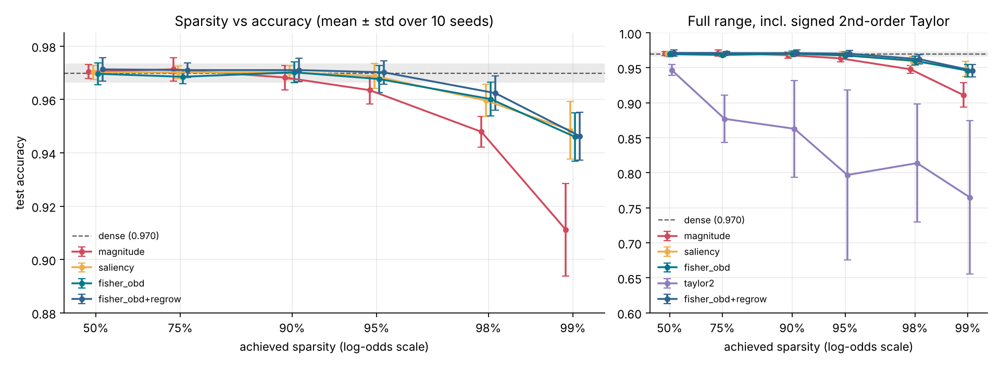

# AQUA: the self-pruning network

A reverse-mode autodiff engine, an MLP library, Adam, and a network that
**prunes itself during training** to a hard sparsity budget. Written from
scratch in Python + NumPy, with measured evidence of what the pruning buys and
what it costs.

> **Restriction compliance.** No PyTorch / TensorFlow / JAX / Keras / HuggingFace
> or any autodiff, pruning or NN library is used. **scikit-learn is used only to
> load the bundled UCI digits dataset** (`sklearn.datasets.load_digits`,
> in `aqua/train/data.py`), never for training, models or gradients. Matplotlib
> is used only for plots.

## Headline results

UCI digits, MLP 64-256-256-10 (84,480 prunable weights), 10 paired seeds
(100–109), held-out test set. Full tables and caveats are in
[DESIGN.md §6](DESIGN.md#6-evidence).



| | dense | 90% sparse | 95% | 98% | 99% |
|---|---|---|---|---|---|
| Fisher-OBD (ours, default) | 96.99 ± 0.39 | 97.02 ± 0.40 | 96.77 ± 0.51 | **96.02 ± 0.63** | **94.60 ± 0.91** |
| magnitude baseline (global) | — | 96.82 ± 0.46 | 96.35 ± 0.52 | 94.79 ± 0.57 | 91.11 ± 1.73 |
| paired difference, p | — | +0.19 pp, p 0.35 | +0.42 pp, p 0.045 | **+1.23 pp, p 0.008** | **+3.48 pp, p 0.002** |
| latency speedup, batch 256 (compacted vs dense) | 1× | 1.24× | 1.92× | 3.98× | 5.58× |
| FLOPs / example (compacted) | 168,960 | 114,440 | 65,716 | 24,036 | 12,560 |

* **Falsifiable claim (pre-registered before the sweep): holds.** At 98%
  sparsity Fisher-OBD beats magnitude by **+1.23 pp** (95% CI
  [+0.70, +1.75]), 9 of 10 seeds, exact permutation p = 0.0078.
  See `results/PREREGISTERED_CLAIM.md` and `results/part4/claim_result.json`.
* **Up to 90% sparsity, any reasonable criterion matches dense.** The
  criterion only matters when the budget is tight.
* **The revival bug is fixed and proven fixed:** a revived connection
  follows a trajectory bit-identical to a fresh parameter. The textbook
  global-step Adam oversteps revived weights by up to 6.5× (closed form,
  confirmed by unit test and by telemetry in real runs). **On this task the
  bug doesn't measurably change final accuracy**; we say so instead of
  claiming otherwise.
* **Negative results we kept:** the signed 2nd-order Taylor criterion is far
  worse than magnitude (−13 to −17 pp at 95–99%, explained in DESIGN §2);
  regrowth gives no significant gain here; our NumPy CSR kernel beats BLAS
  only at batch 1 on large layers. The real latency win comes from exact
  compaction of the units that pruning killed.

## Install

Python ≥ 3.10.

```bash
uv venv && uv pip install -r requirements.txt      # or: pip install -r requirements.txt
# optional: uv pip install -e ".[dev]"  (adds pytest; the suite also runs on stdlib unittest)
```

## Reproduce

Every script pins BLAS to one thread, so runs are **bitwise reproducible**;
parallelism comes from running seeds in separate processes.

| What | Command | Output | Time (2 cores) |
|---|---|---|---|
| Gradient-check + correctness tests | `python -m unittest discover -s tests -t . -v` (or `pytest`) | pass/fail | ~5 s |
| Part 2: train dense MLP (Adam, SGD-momentum, spirals) | `python scripts/train_dense.py` | `results/part2/` | ~15 s |
| Part 3: one self-pruning run (90%, Fisher-OBD, regrowth) | `python scripts/self_prune.py` | `results/part3/` | ~15 s |
| Part 4: Pareto sweep, baselines, ablations, claim | `python scripts/sweep.py` | `results/part4/` | ~30 min |
| Part 4: real cost measurement | `python scripts/benchmark.py` | `results/part4/cost*` | ~3 min |
| Quick smoke run of the sweep | `python scripts/sweep.py --quick` | `results/part4_quick/` | ~3 min |

`self_prune.py` accepts `--sparsity --criterion {magnitude,saliency,taylor2,fisher_obd} --scope {global,layer} --no-regrow --seed`.
Run `benchmark.py` on an idle machine; it measures wall-clock time.

## Layout

```
aqua/
  engine/     tensor.py (Tensor, ops, backward), gradcheck.py
  nn/         Parameter (with mask), MaskedLinear, activations, MLP, init
  optim/      Adam (per-entry bias correction), SGD-momentum; both mask-aware
  prune/      criteria.py, schedule.py (cubic), pruner.py (budget, regrowth), telemetry.py
  sparse/     csr.py (CSR kernel), inference.py (dense / CSR / compacted engines)
  train/      data.py (digits, spirals, batching), loop.py (Trainer, hooks)
  experiment.py   one seeded experiment = one function call
  stats.py        paired permutation test, bootstrap CI
scripts/      train_dense.py, self_prune.py, sweep.py, benchmark.py
tests/        test_gradcheck.py, test_masked.py, test_pruning.py, test_sparse.py, test_claim.py
results/      committed plots + raw CSV/JSON;  PREREGISTERED_CLAIM.md
DESIGN.md     derivations and design decisions (answers the four questions in the brief)
```

## What the tests pin down

* **`test_gradcheck.py`**: central-difference checks (float64, random output
  projection) for every op: add, sub, mul and div under 5 broadcasting
  patterns including `(N,D)+(D,)`, matmul (2-D and batched), sum and mean on
  every axis/keepdims, ReLU, tanh, sigmoid, GELU, exp, log, reshape, transpose,
  softmax, log-softmax, and fused softmax-cross-entropy (3 reductions, stable
  at ±5·10⁴ logits), plus a whole MLP. Also covers engine semantics:
  accumulation on reuse, diamond graphs, 5000-deep graphs, `no_grad`, and
  non-aliased gradient buffers.
* **`test_masked.py`** (the Part 1 correctness requirement):
  * masked weights contribute exactly 0, even when their storage is
    overwritten with 1e6;
  * ∂L/∂W at a masked entry is **exactly 0**, and finite differences agree
    that this is the true derivative;
  * the dense ∂L/∂W_eff stays available for regrowth;
  * removed entries never move and their Adam/SGD state stays exactly 0
    (including under weight decay);
  * the naive mask-unaware Adam *does* drift a pruned weight (documented
    failure);
  * **the revival test:** a connection revived at step 5000 follows a
    trajectory identical to a fresh parameter (rtol 1e-12), while textbook
    global-step Adam oversteps by the predicted closed form (3.16× on the
    first step, about 6.5× peak);
  * the optimized Adam matches a direct reference implementation under random
    mask churn.
* **`test_pruning.py`**: the cubic schedule is monotone and lands exactly on
  target; the per-example Fisher trick equals brute force; the hard budget is
  exact per layer and global (also with an infeasible floor); regrowth keeps
  the budget; runs are bitwise reproducible.
* **`test_sparse.py`**: CSR, CSR-engine and compacted-engine outputs equal the
  training forward pass (relu, tanh, gelu at 0–97% sparsity); FLOP counts
  scale with nnz; dead-unit compaction is exact, including cascades.
* **`test_claim.py`** re-derives the pre-registered claim from the committed
  raw CSV, and checks that every one of the sweep runs met its budget.

## Where to look

* The bug: [DESIGN.md §4](DESIGN.md#4-optimizer-and-the-revival-bug), `aqua/optim/optimizers.py`, `tests/test_masked.py::RevivalBug`
* Criterion derivation: [DESIGN.md §2](DESIGN.md#2-importance-criterion)
* Masked-gradient semantics: [DESIGN.md §3](DESIGN.md#3-gradient-of-a-masked-weight)
* Bottlenecks and serving: [DESIGN.md §7–8](DESIGN.md#7-bottlenecks)
